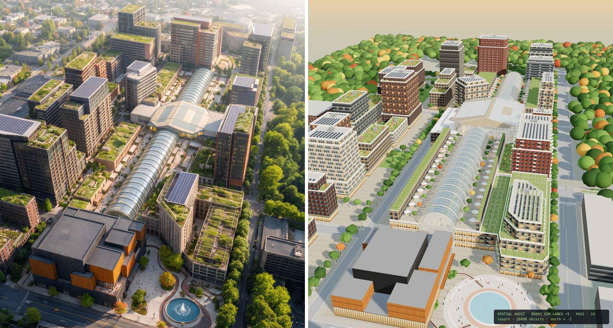
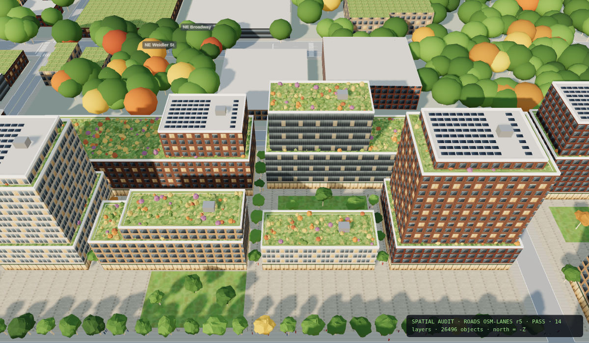
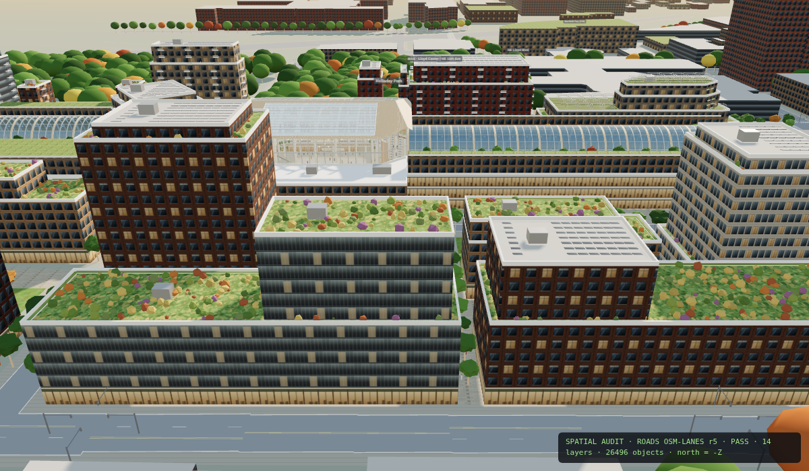

# Lloyd Commons — Megablock Concept Model




A georeferenced, interactive Three.js model of the Lloyd Commons superblock in NE Portland, Oregon, bounded by NE Halsey, NE Multnomah, 9th Ave and the curved east perimeter road. A Python generator turns site data and design rules into `layout.json`. A bundler then inlines the layout, Three.js and the scene code into one self-contained HTML viewer.

## Quick start
```bash
python3 -m venv .venv && source .venv/bin/activate   # Windows: .venv\Scripts\activate
pip install -r requirements.txt
make all          # gen_layout.py -> layout.json, invariant audit, build_viewer.py -> dist/viewer.html
make serve        # open http://localhost:8000/dist/viewer.html
```
If you don't have `make`, run `python gen_layout.py` and then `python build_viewer.py`. You can also open `dist/viewer.html` directly, because it has no external dependencies.

## Pipeline
```
scene.json (OSM-derived site, streets, context)  ─┐
osm_lane_tags.json + osm_fit.json (lane data)     ├─> gen_layout.py ──> layout.json ──┐
road_marks.py (exec'd inside gen_layout)          ─┘   (gates: collisions,            │
                                                        lanes, depth, height caps)     ├─> build_viewer.py ──> dist/viewer.html
commons.js (scene builder) + app.js (UI/camera) + style.css + body.html + three.min.js ┘
```

| File | Role |
|---|---|
| `gen_layout.py` | The generator: buildings, core and vaults, crossing hall, venue, routes, trees, people, roof kit, stats. It asserts the invariants and fails loudly. |
| `road_marks.py` | Street markings from OpenStreetMap lane tags. It runs in its own namespace, called from `gen_layout.py`. |
| `commons.js` | Three.js scene: materials, procedural facade textures, building meshes, details, camera presets. |
| `app.js` | Renderer, lights, fog, controls, audit chip. |
| `build_viewer.py` | Bundles everything into one HTML file. `python build_viewer.py dist/x.html <preset>` writes a page locked to one camera preset. |
| `scene.json` | Site boundary, streets and context, built from `osm_raw.json` by `process_osm.py`. |
| `tools/check_invariants.py` | Independent audit of `layout.json`: overlaps, 18-floor cap, every upper tier supported, routes and lanes clear, north depth ≤ 64.5 m, Pyramid tip. Runs in CI. |
| `tools/` | `solve_cam.py` solves the camera from ref_04; `overlay_ref.py` projects footprints onto ref_04; `metrics.py` computes height and coverage metrics. |
| `references/` | Reference renders. **`site_ref/ref_04.jpg` is the master.** |
| `docs/` | Source books: *The Lloyd Commons*, *Civic Asset Trust Model*, plus text extracts and page images. |
| `legacy/` | Earlier generators and plan outputs (shadow study, site plan, tech plan). Not part of the current pipeline. |

## Camera presets
Open `dist/viewer.html?` and use the in-app menu, or bundle a locked page with `make view-<name>`:
`refaerial` (matches ref_04), `northrow`, `northhalsey`, `pyramidtop`, `pyramidobl`, `pyramidc1`, `routejunction`, `routeobl`, `roads9mult`, `roadsmult`, `roadshalsey`, `plan`, `hero`, `hall`, `galleria`, `roofpark`, `dusk`, and others listed in `commons.js` → `presets`.

## Views
| North row from the Commons spine | North row from Halsey |
|---|---|
|  |  |

## Reproducibility
The generator is deterministic (`random.seed(11)`, `Random(4417)`). Two runs produce a byte-identical `layout.json`. CI regenerates it on every push and fails if the committed copy is stale.

## Current state
- FAR 3.29, 2,040 units, 18-floor cap, 65 building records (26 ground footprints).
- The north perimeter rows were rebuilt to match the references (11 buildings, from 55 fragments).
- See `docs/CONTEXT.md` for coordinate conventions, invariants, design decisions and open issues. **Read it before changing geometry.**
